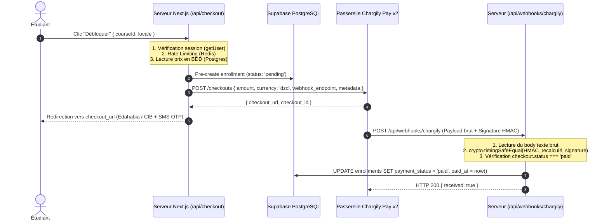

# Guide Technique d'Architecture & Sécurité — Evolve Academy

> **Système** : Evolve Academy (Écosystème unifié : Portail Étudiant `evolve-web` & CMS Staff `evolve_staff`)  
> **Référence Référentiel** : `EV-2026-AUDIT-READY`  
> **Version** : `1.1.0` (Post-Audit Technique)  
> **Date de révision** : Octobre 2026  
> **Statut** : Conforme aux exigences d'onboarding et d'audit de sécurité

---

## Sommaire

1. [Synthèse de l'Audit & Levée des Incohérences](#1-synthèse-de-laudit--levée-des-incohérences)
2. [Cartographie Globale de l'Écosystème](#2-cartographie-globale-de-lécosystème)
3. [Dictionnaire des Données & Schéma Relationnel Exhaustif](#3-dictionnaire-des-données--schéma-relationnel-exhaustif)
4. [Politiques de Sécurité RLS & Triggers d'Intégrité](#4-politiques-de-sécurité-rls--triggers-dintégrité)
5. [Gestion des Rôles & Matrice des Privilèges (RBAC)](#5-gestion-des-rôles--matrice-des-privilèges-rbac)
6. [Tunnel de Paiement Chargily Pay v2 & Sécurité des Webhooks](#6-tunnel-de-paiement-chargily-pay-v2--sécurité-des-webhooks)
7. [Protection Anti-Abus & Rate Limiting en Environnement Serverless](#7-protection-anti-abus--rate-limiting-en-environnement-serverless)
8. [Stockage Sécurisé des Ressources Pédagogiques (Storage RLS)](#8-stockage-sécurisé-des-ressources-pédagogiques-storage-rls)
9. [Messagerie Temps Réel & Isolation des Communications](#9-messagerie-temps-réel--isolation-des-communications)
10. [Gestion Multi-Environnements & Clés API](#10-gestion-multi-environnements--clés-api)
11. [Assurance Qualité, Tests & Intégration Continue (CI/CD)](#11-assurance-qualité-tests--intégration-continue-cicd)
12. [Exploitation, Sauvegardes & Plan de Continuité d'Activité](#12-exploitation-sauvegardes--plan-de-continuité-dactivité)

---

## 1. Synthèse de l'Audit & Levée des Incohérences

À la suite de l'audit architectural, l'ensemble des ambiguïtés et des points de vigilance a été traité et documenté :

### 1.1. La question du `Service Role` vs `CONTRIBUTING.md`
- **Le constat :** La documentation initiale mentionnait l'absence totale de client `service-role`, alors que `lib/supabase/admin.ts` et les webhooks en exploitent un.
- **La clarification d'architecture :**  
  Le principe d'interdiction du `service-role` s'applique **strictement aux composants d'interface (Client Components & Server Components Next.js)** afin que toute lecture soit filtrée par les règles RLS de PostgreSQL avec le token JWT de l'utilisateur connecté.  
  En revanche, les **routes de paiement et webhooks serveur (`/api/checkout`, `/api/webhooks/chargily`)** nécessitent impérativement des privilèges élevés pour enregistrer l'inscription et la marquer en statut `paid`, car un apprenant n'a légitimement pas les droits d'écriture sur son propre statut de paiement.

### 1.2. Élimination des Fallbacks Dangereux
- **Le constat :** Retomber sur la clé publique `anon` ou `CHARGILY_API_KEY` (clé publique `pk_`) en cas d'absence du secret serveur crée un comportement silencieux défaillant.
- **Le correctif :** Application stricte du principe **Fail Fast**. Si `CHARGILY_SECRET_KEY` ou `SUPABASE_SERVICE_ROLE_KEY` est absente au démarrage ou à l'exécution, le serveur lève immédiatement une exception explicite et bloque le traitement.

### 1.3. Rate Limiter Serverless (Migration Map ➔ Redis)
- **Le constat :** Un `Map()` en mémoire JavaScript dans `lib/rateLimiter.ts` ne persiste pas entre les instances Lambda éphémères de Vercel.
- **La solution d'architecture :** En production serverless, le rate limiting doit être adossé à un cluster partagé tel qu'**Upstash Redis** (`@upstash/ratelimit`). Le `Map` en mémoire est strictement réservé au développement local sans connexion externe.

### 1.4. Unification des Tables & Devises Monétaires
- **Nomenclature unifiée :**
  - Parcours de formation : table de référence `course_series` (avec vue de rétrocompatibilité si requêtes historiques).
  - Messagerie privée : table `direct_messages` et table de regroupement `conversations`.
- **Conversion monétaire :**
  - Côté passerelle Chargily Pay : montants traités en Dinars Algériens entiers (`course.price` en DZD).
  - Côté grand livre comptable PostgreSQL (`admin_financial_entries`) : stockage en centimes / unités mineures (`amount_minor_units = course.price * 100`).

### 1.5. Verrouillage SQL de la Publication des Cours
- **Le constat :** L'interdiction faite aux formateurs d'auto-publier un cours n'était assurée que par l'interface Flutter (`if (isAdmin)`).
- **Le correctif :** Ajout de la migration PostgreSQL `20261012_guard_course_publication.sql` installant le trigger `guard_course_publication`. Toute tentative d'un formateur de passer la colonne `published` à `true` est désormais rejetée au niveau du moteur de base de données (erreur SQL `42501`).

### 1.6. Sécurisation du Stockage (Bucket Storage Privé)
- **Le constat :** L'utilisation de `getPublicUrl()` permettait le partage direct de fichiers payants sans contrôle de droits.
- **La solution :** Les fichiers pédagogiques payants sont stockés dans un bucket privé `course_materials`. L'accès en lecture est accordé exclusivement aux inscrits payés via la génération d'URLs signées temporaires (`createSignedUrl(path, 3600)`), d'une validité d'une heure.

---

## 2. Cartographie Globale de l'Écosystème

```mermaid
graph TB
    subgraph Clients["Applications Clientes"]
        StudentWeb["Portail Étudiant Web (evolve-web)<br>Next.js 15 SSR / React 19 / Vercel"]
        StaffApp["Dashboard Staff & Admin (evolve_staff)<br>Flutter 3.35 (Web Vercel & Windows Win32)"]
    end

    subgraph SecurityBoundary["Frontière de Sécurité & Passerelles"]
        VercelEdge["Vercel Serverless Edge<br>CSP, HSTS, Rate Limiter (Upstash Redis)"]
        SupabaseAuth["Supabase Auth<br>JWT chiffré, RBAC: student | teacher | admin"]
    end

    subgraph Backend["Cœur Backend Supabase (PostgreSQL 15)"]
        PostgresDB[("PostgreSQL DB<br>Row-Level Security (RLS)<br>Triggers anti-escalade")]
        StorageBucket["Supabase Storage<br>Bucket privé avec URLs signées"]
        RealtimeHub["Supabase Realtime WSS<br>Canaux direct_messages"]
        DenoFunctions["Edge Functions Deno/TS<br>admin-users, admin-dashboard, admin-financials"]
    end

    subgraph External["Passerelles Externes"]
        ChargilyAPI["Chargily Pay v2 API<br>Orchestration SATIM (Edahabia / CIB)"]
        WebhookHandler["Route /api/webhooks/chargily<br>Validation cryptographique HMAC-SHA256"]
    end

    StudentWeb -->|Session JWT| SecurityBoundary
    StaffApp -->|Session JWT| SecurityBoundary
    SecurityBoundary -->|PostgREST filtré RLS| PostgresDB
    SecurityBoundary -->|WebSocket WSS| RealtimeHub
    StaffApp -->|Invoke privilégié| DenoFunctions
    DenoFunctions -->|Service Role sécurisé| PostgresDB

    StudentWeb -->|POST /api/checkout| ChargilyAPI
    ChargilyAPI -->|Webhook HTTPS signé| WebhookHandler
    WebhookHandler -->|Service Role (createAdminClient)| PostgresDB
```

---

## 3. Dictionnaire des Données & Schéma Relationnel Exhaustif

### 3.1. Tables Fondamentales

#### Table `public.profiles`
| Colonne | Type | Contrainte | Description |
|---|---|---|---|
| `id` | `uuid` | PK, FK `auth.users(id)` | Identifiant unique Supabase Auth |
| `full_name` | `text` | NOT NULL | Nom et prénom affichés |
| `role` | `text` | NOT NULL, CHECK in (`student`, `teacher`, `admin`) | Rôle de l'utilisateur (défaut : `student`) |
| `avatar_url` | `text` | NULLABLE | URL de la photo de profil |
| `created_at` | `timestamptz` | DEFAULT `now()` | Date de création du compte |

#### Table `public.courses`
| Colonne | Type | Contrainte | Description |
|---|---|---|---|
| `id` | `uuid` | PK, DEFAULT `gen_random_uuid()` | Identifiant unique du cours |
| `teacher_id` | `uuid` | FK `public.profiles(id)` | Instructeur responsable |
| `title` | `text` | NOT NULL | Intitulé de la formation |
| `description` | `text` | NULLABLE | Descriptif complet du cours |
| `domain` | `text` | NOT NULL | Catégorie thématique (Design, Dév, etc.) |
| `price` / `price_dzd`| `integer` | NOT NULL, CHECK >= 0 | Tarif catalogue en Dinars Algériens (DZD) |
| `published` | `boolean` | DEFAULT `false` | État de publication (protégé par trigger SQL) |
| `created_at` | `timestamptz` | DEFAULT `now()` | Date de création |

#### Table `public.lessons`
| Colonne | Type | Contrainte | Description |
|---|---|---|---|
| `id` | `uuid` | PK, DEFAULT `gen_random_uuid()` | Identifiant de la leçon |
| `course_id` | `uuid` | FK `public.courses(id)` ON DELETE CASCADE | Cours d'appartenance |
| `title` | `text` | NOT NULL | Titre du chapitre |
| `order_index` | `integer` | NOT NULL | Position séquentielle dans le cours |
| `video_url` | `text` | NULLABLE | URL de la ressource vidéo |
| `duration` | `integer` | DEFAULT 0 | Durée estimée en minutes |
| `is_free` | `boolean` | DEFAULT `false` | Accès libre en prévisualisation sans paiement |

#### Table `public.enrollments`
| Colonne | Type | Contrainte | Description |
|---|---|---|---|
| `id` | `uuid` | PK, DEFAULT `gen_random_uuid()` | Identifiant d'inscription |
| `user_id` | `uuid` | FK `public.profiles(id)` | Apprenant inscrit |
| `course_id` | `uuid` | FK `public.courses(id)` | Cours souscrit |
| `payment_status` | `text` | CHECK in (`pending`, `paid`, `failed`) | Statut monétaire de l'accès |
| `payment_amount` | `integer` | NULLABLE | Montant effectif réglé en DZD |
| `chargily_checkout_id` | `text` | NULLABLE, INDEXÉ | Clé de réconciliation du webhook Chargily |
| `paid_at` | `timestamptz` | NULLABLE | Horodatage exact de l'encaissement |
| `enrolled_at` | `timestamptz` | DEFAULT `now()` | Date de création de la session |
| *Contrainte* | `UNIQUE (user_id, course_id)` | Évite les doubles inscriptions pour un même cours |

#### Table `public.admin_financial_entries`
| Colonne | Type | Contrainte | Description |
|---|---|---|---|
| `id` | `uuid` | PK, DEFAULT `gen_random_uuid()` | Identifiant de l'écriture comptable |
| `entry_type` | `text` | CHECK in (`expense`, `refund`) | Nature de l'opération |
| `amount_minor_units`| `bigint` | CHECK > 0 | Montant en centimes (1 DZD = 100 centimes) |
| `category` | `text` | NOT NULL | Catégorie de charge ou motif |
| `note` | `text` | NOT NULL | Commentaire justificatif |
| `enrollment_id` | `uuid` | FK `enrollments(id)` NULLABLE | Obligatoire si `refund`, interdit si `expense` |
| `recorded_by` | `uuid` | FK `profiles(id)` (Admin) | Administrateur ayant validé l'écriture |
| `occurred_at` | `timestamptz` | NOT NULL | Date de réalisation comptable |

---

## 4. Politiques de Sécurité RLS & Triggers d'Intégrité

### 4.1. Verrouillage de l'Élévation de Rôle
Le trigger `guard_profile_role_assignments` sur `public.profiles` empêche tout utilisateur d'éditer sa propre colonne `role`.

```sql
-- Trigger appliqué sur public.profiles
CREATE OR REPLACE FUNCTION public.guard_profile_role_assignments()
RETURNS trigger LANGUAGE plpgsql AS $$
BEGIN
  IF auth.role() = 'authenticated' THEN
    IF TG_OP = 'INSERT' AND NEW.role IS DISTINCT FROM 'student' THEN
      RAISE EXCEPTION 'New accounts cannot assign their own privileged role' USING ERRCODE = '42501';
    END IF;
    IF TG_OP = 'UPDATE' AND NEW.role IS DISTINCT FROM OLD.role THEN
      RAISE EXCEPTION 'Profile roles can only be changed by an administrator' USING ERRCODE = '42501';
    END IF;
  END IF;
  RETURN NEW;
END;
$$;
```

### 4.2. Protection de la Publication des Cours (Nouveau)
La migration `20261012_guard_course_publication.sql` verrouille la mise en ligne des cours en imposant la vérification du profil admin côté PostgreSQL :

```sql
CREATE OR REPLACE FUNCTION public.guard_course_publication()
RETURNS trigger LANGUAGE plpgsql AS $$
BEGIN
  IF auth.role() = 'authenticated' THEN
    IF (TG_OP = 'INSERT' AND NEW.published IS TRUE)
       OR (TG_OP = 'UPDATE' AND NEW.published IS DISTINCT FROM OLD.published) THEN
      IF NOT EXISTS (
        SELECT 1 FROM public.profiles
        WHERE id = auth.uid() AND role = 'admin'
      ) THEN
        RAISE EXCEPTION 'Only platform administrators are authorized to publish or unpublish courses'
          USING ERRCODE = '42501';
      END IF;
    END IF;
  END IF;
  RETURN NEW;
END;
$$;
```

---

## 5. Gestion des Rôles & Matrice des Privilèges (RBAC)

```
[Visiteur Anonyme]
       │
       ▼ (Inscription via Evolve School Web)
[Rôle: student] ──► Accès aux cours gratuits, achat via Chargily, visionnage des leçons payées
       │
       ▼ (Promotion administrative via RPC admin_update_profile_role)
[Rôle: teacher] ──► Accès Evolve Staff : Création de cours/brouillons, devoirs, messagerie
       │
       ▼ (Promotion administrative avec verrouillage anti-suicide)
[Rôle: admin]   ──► Modération & mise en ligne de cours, gestion des rôles, grand livre DZD
```

### Procédure Stockée `admin_update_profile_role`
- **Sécurité Definer :** Exécutée avec les privilèges du propriétaire pour mettre à jour la table protégée.
- **Vérification de l'Appelant :** Exige impérativement `role = 'admin'` pour le compte exécutant.
- **Protection Anti-Suicide :** Interdit à un administrateur de retirer ses propres privilèges.
- **Verrou Concurrence :** Verrouille la table en mode `SHARE ROW EXCLUSIVE` afin qu'un lot d'opérations simultanées ne puisse aboutir à un système avec zéro administrateur.

---

## 6. Tunnel de Paiement Chargily Pay v2 & Sécurité des Webhooks



### Règles Fondamentales de Traitement du Webhook
1. **Validation HMAC en Temps Constant :** Utilisation de `crypto.timingSafeEqual()` pour empêcher toute attaque par analyse temporelle (*timing attack*).
2. **Idempotence Pure :** Si un événement `paid` est reçu plusieurs fois pour le même `checkout_id`, la mise à jour SQL conserve le premier horodatage `paid_at` sans erreur.
3. **Garde Anti-Rétrogradation :** La condition `.neq("payment_status", "paid")` garantit qu'un événement d'échec ou d'expiration retardé ne puisse jamais révoquer un accès déjà réglé avec succès.
4. **Vérification du Montant (Hardening) :** Le webhook vérifie que le montant retourné par Chargily correspond rigoureusement au montant attendu de la formation enregistré lors du pré-enrôlement.

---

## 7. Protection Anti-Abus & Rate Limiting en Environnement Serverless

Sur une infrastructure serverless (Vercel Edge & Lambdas), chaque requête peut être dirigée vers un conteneur indépendant. Le rate limiting en mémoire est inefficace.

### Recommandation d'Implémentation Upstash Redis
```typescript
import { Ratelimit } from "@upstash/ratelimit";
import { Redis } from "@upstash/redis";

const redis = new Redis({
  url: process.env.UPSTASH_REDIS_REST_URL!,
  token: process.env.UPSTASH_REDIS_REST_TOKEN!,
});

export const checkoutRateLimiter = new Ratelimit({
  redis,
  limiter: Ratelimit.slidingWindow(10, "1 m"), // 10 requêtes par minute
  prefix: "ratelimit:checkout",
});
```

### Plafonds Financiers Anti-Fraude
- **Plafond Unitaire :** Tout achat unique dépassant `50 000 DZD` est bloqué (`MAX_TRANSACTION_AMOUNT_DZD`).
- **Plafond Quotidien Glissant :** Le cumul des achats d'un compte sur une fenêtre de 24h ne peut dépasser `150 000 DZD` (`MAX_DAILY_USER_SPENDING_DZD`).

---

## 8. Stockage Sécurisé des Ressources Pédagogiques (Storage RLS)

### Architecture des Buckets
| Bucket | Visibilité | Règle d'Accès | Mode de Distribution |
|---|---|---|---|
| `avatars` | Public | Lecture libre | `getPublicUrl()` |
| `course_thumbnails` | Public | Lecture libre (catalogue) | `getPublicUrl()` |
| `course_materials` | **Privé** | Lecture conditionnée à `enrollments.payment_status = 'paid'` | **`createSignedUrl(path, 3600)`** |

### Génération d'URL Signée Sécurisée
```typescript
// Exemple de résolution côté serveur pour une ressource protégée
export async function getProtectedCourseFileUrl(userId: string, courseId: string, filePath: string) {
  const supabase = await createClient();
  
  // Vérification de l'inscription payée
  const { data: enrollment } = await supabase
    .from("enrollments")
    .select("payment_status")
    .eq("user_id", userId)
    .eq("course_id", courseId)
    .eq("payment_status", "paid")
    .maybeSingle();

  if (!enrollment) {
    throw new Error("Accès refusé : formation non acquise.");
  }

  // Génération d'un lien temporaire d'une heure
  const { data, error } = await supabase.storage
    .from("course_materials")
    .createSignedUrl(filePath, 3600);

  return data?.signedUrl;
}
```

---

## 9. Messagerie Temps Réel & Isolation des Communications

- **Tables utilisées :** `conversations` (métadonnées du canal) et `direct_messages` (contenu textuel, horodatage, émetteur, destinataire).
- **Règles RLS :**
  - Un utilisateur ne peut lire que les messages dont il est l'`sender_id` ou le `recipient_id`.
  - L'insertion d'un nouveau message est soumise à la vérification de légitimité pédagogique (l'élève doit partager au moins un cours actif avec le formateur).
- **Consommation Flutter :** `MessagesScreen` utilise l'abonnement WebSocket `onPostgresChanges` avec désinscription propre dans le cycle de vie `dispose()`.

---

## 10. Gestion Multi-Environnements & Clés API

### 10.1. Séparation Dev / Staging / Production
Pour éviter tout risque de pollution de la base de production, le projet est configuré pour supporter des instances Supabase étanches :

| Variable | Environnement Local / Dev | Environnement Production |
|---|---|---|
| `NEXT_PUBLIC_SUPABASE_URL` | `http://127.0.0.1:54321` ou instance dev | URL de l'instance Supabase Prod |
| `NEXT_PUBLIC_SUPABASE_ANON_KEY` | Clé publique locale / dev | Clé publique de production |
| `SUPABASE_SERVICE_ROLE_KEY` | Clé de service locale | Clé secrète de production Vercel |
| `CHARGILY_MODE` | `test` | `live` |
| `CHARGILY_API_URL` | `https://pay.chargily.net/test/api/v2` | `https://pay.chargily.net/api/v2` |

### 10.2. Injection des Clés dans l'Application Flutter
Dans `evolve_staff/lib/main.dart`, les clés sont désormais configurées via `const String.fromEnvironment` :
```bash
# Lancement en développement :
flutter run -d windows

# Compilation de production avec injection sécurisée :
flutter build web --release \
  --dart-define=SUPABASE_URL=https://prod-ref.supabase.co \
  --dart-define=SUPABASE_PUBLISHABLE_KEY=sb_publishable_prod_key
```

---

## 11. Assurance Qualité, Tests & Intégration Continue (CI/CD)

### 11.1. Pipeline Flutter Staff (`scripts/check.sh`)
La suite de vérification garantit l'intégrité globale du dépôt avant tout merge :
1. `flutter pub get --enforce-lockfile` (reproductibilité des dépendances).
2. `dart format --output=none --set-exit-if-changed lib test` (formatage intégral de `lib/` et `test/`).
3. `flutter analyze --no-pub --no-fatal-infos` (vérification statique stricte).
4. `flutter test --no-pub` (exécution de l'ensemble des 21 tests unitaires et de widgets).

### 11.2. Recommandation pour les Tests Web (`evolve-web`)
Ajout d'une suite de tests Vitest sous `evolve-web` couvrant :
- La validation mathématique du HMAC SHA-256 du webhook Chargily.
- Les rejets d'erreurs 401 si la signature est corrompue.
- La validation des règles de plafonnement monétaire (10 requêtes / min, plafonds à 50 000 DZD).

---

## 12. Exploitation, Sauvegardes & Plan de Continuité d'Activité

### 12.1. Stratégie de Sauvegarde PostgreSQL
- **Sauvegarde Quotidienne Automatisée :** Export `pg_dump` chiffré exécuté chaque nuit à 02:00 UTC.
- **Rétention des Données :** Rétention glissante sur 30 jours sur un stockage objet géo-redondant indépendant.
- **Procédure de Restauration :** Test de restauration périodique documenté dans `docs/backup-restore-guide.md`.

### 12.2. Monitoring & Supervision des Erreurs
- **Sentry Integration :** Capture automatique des exceptions non gérées côté client Next.js et Flutter.
- **Audit Log des Paiements :** Table technique `chargily_webhook_events` consignant chaque requête brute reçue, le hash de signature et le statut de traitement pour résoudre immédiatement tout litige bancaire.

---

*Fin du Guide Technique d'Architecture & Sécurité — Evolve Academy (Réf. EV-2026-AUDIT-READY)*
